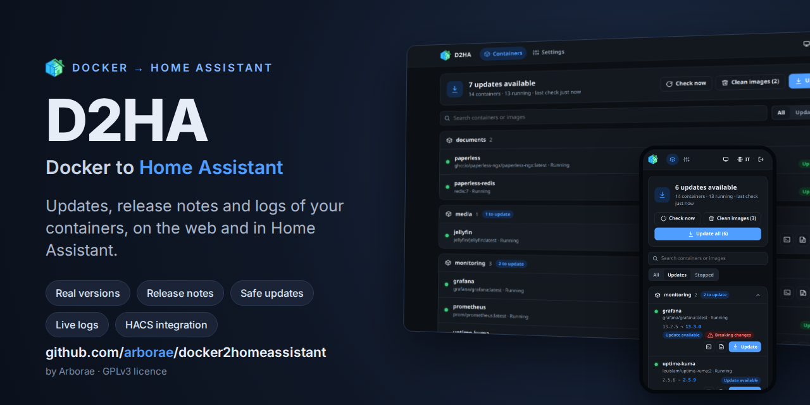
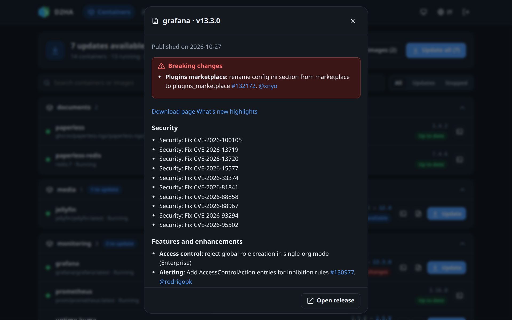
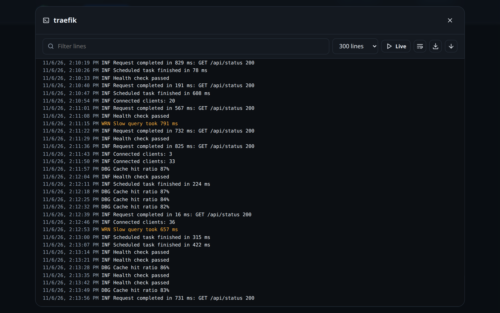
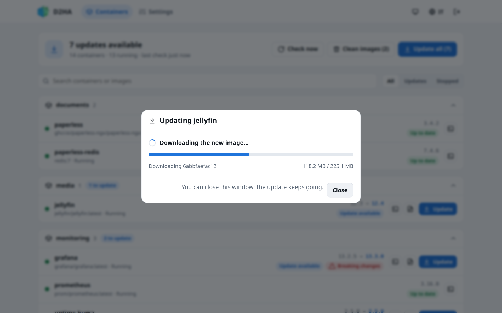
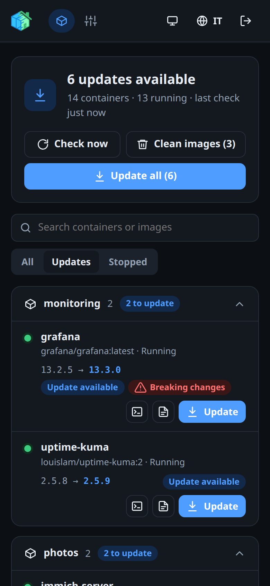
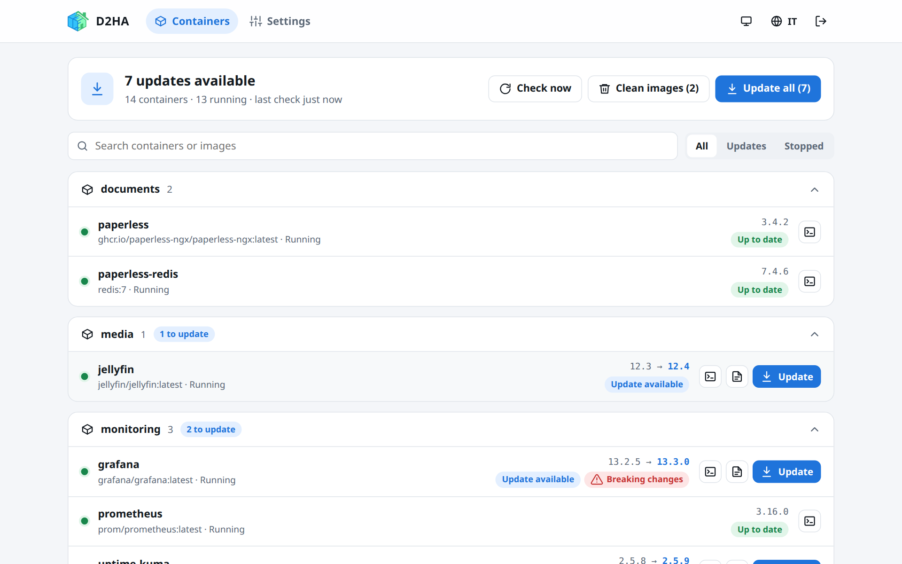
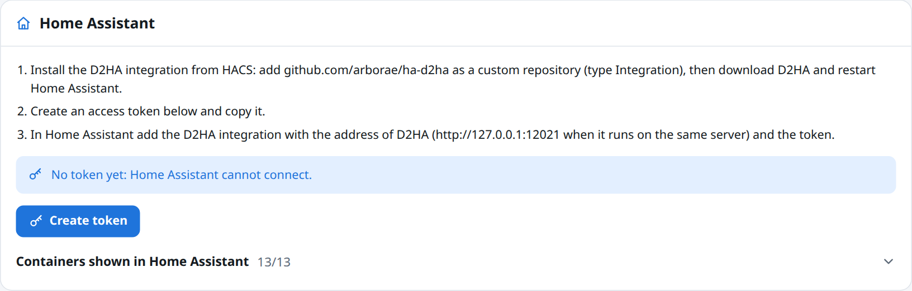

# D2HA – Docker to Home Assistant

Know when your containers have updates, read what changed, update them safely and read their logs: in a small web app and in Home Assistant.

D2HA is a container that watches your Docker host. It finds the real new version of each image, shows its release notes (with breaking changes in red), updates containers keeping their settings, and lets you read and follow their logs. A Home Assistant integration brings all of it to your dashboards as native update entities.

**Documentation:** [arborae.github.io/docker2homeassistant/guide](https://arborae.github.io/docker2homeassistant/guide/), one page per topic: installation, updates, logs, settings, Home Assistant, Telegram, configuration, security, API and troubleshooting.

> Status: 0.4 is a rewrite from scratch, focused on these few things. Older versions also managed networks, volumes and images and talked to Home Assistant over MQTT: see [CHANGELOG.md](CHANGELOG.md).

## What it does

- **Real versions.** The digest of each tag is read from the registry with a `HEAD` request (free on Docker Hub); only when it changed, D2HA reads the labels of the new image, so you see `13.2.5 → 13.3.0`, not just "something changed". Private registries work through the Docker daemon. Images built locally are recognised and skipped.
- **Release notes that match.** The GitHub release of that exact version, found through the image `org.opencontainers.image.source` label, with the breaking changes highlighted.
- **Safe updates.** The new image is downloaded while the container keeps running, then the container is recreated with the settings you gave it: environment, volumes (anonymous ones too), networks and aliases, ports, restart policy. If the new container does not start, the old one is put back. Update one container or all of them, with live progress; closing the page does not stop an update.
- **Image cleanup.** Remove the images no container uses any more.
- **Telegram notifications.** A message when a new version is out (once per version, with the release notes and a warning for breaking changes), when a container stops with an error and when it becomes unhealthy.
- **Logs.** The last lines or the live stream, with search, levels in colour, wrap and download.
- **Home Assistant.** An integration for Home Assistant 2026.8 or later, from the Marketplace (HACS before 2026.11): an update entity for each container (install and release notes from Home Assistant), container states, counters, and buttons to check, update all and clean images.
- **Private by design.** Sign-in with optional two-factor authentication, no third-party requests from the browser, no environment variables or secrets shown, and an example setup where D2HA reaches Docker only through a socket proxy.
- **Everywhere.** Light and dark theme, English and Italian, installable as an app on phones and computers.

|  |  |
| :---: | :---: |
| Release notes of the new version | Logs, live |
|  |  |
| Updating a container | On a phone |



## Installation

### 1. The container

D2HA needs Docker (Engine 24 or newer) on an amd64 or arm64 machine. Copy [`compose.example.yaml`](compose.example.yaml) to a new folder as `compose.yaml`, read it, then:

```bash
docker compose up -d
docker logs d2ha
```

The log shows a **setup code**. Open D2HA, enter the code and create your account. The example listens on `127.0.0.1` only, so:

- in a browser on the server itself, open `http://localhost:12021`;
- from another computer, open an SSH tunnel first (`ssh -L 12021:localhost:12021 <user>@<server>`), then `http://localhost:12021` on that computer;
- or go through your reverse proxy or tunnel, if you already have one.

The example starts two containers:

- `d2ha`, published on `127.0.0.1:12021` only: Home Assistant on the same host, a reverse proxy or a tunnel can reach it, the rest of the network cannot;
- `docker-proxy` ([linuxserver/socket-proxy](https://github.com/linuxserver/docker-socket-proxy)), so D2HA never touches the Docker socket: it allows only the calls D2HA needs, and no `exec`, volumes or networks.

Options (all optional) are listed in [`.env.example`](.env.example): the hours between checks, Telegram notifications, a GitHub token for release notes (raises the GitHub limit from 60 to 5,000 requests per hour), a read-only mode, and the Home Assistant address allowed to show D2HA in an iframe.

### 2. Home Assistant

[](https://my.home-assistant.io/redirect/marketplace_repository/?owner=arborae&repository=ha-d2ha&category=integration)

1. Install the integration (it needs Home Assistant 2026.8 or later). The link above opens it in the Marketplace (or in HACS) and offers to add it.
   - **Home Assistant 2026.11 or later:** open **Settings → Marketplace → Add from link**, enter `https://github.com/arborae/ha-d2ha` with type **Integration** (the first time, the Marketplace asks you to connect GitHub), then **Install** and **Restart Home Assistant**.
   - **Home Assistant 2026.8 to 2026.10:** in HACS, add `https://github.com/arborae/ha-d2ha` as a custom repository of type **Integration**, download **D2HA** and restart Home Assistant.
2. In D2HA, open **Settings → Home Assistant** and create a token.
3. In Home Assistant, **Settings → Devices & services → Add integration → D2HA**: enter the address of D2HA (`http://127.0.0.1:12021` when Home Assistant runs on the same host with `network_mode: host`) and the token.



In **Settings → Home Assistant** you can also choose which containers appear in Home Assistant.

### 3. Telegram notifications (optional)

1. Create a bot with [@BotFather](https://t.me/BotFather) and copy its token; send the bot a message, then read your chat id (for example with [@userinfobot](https://t.me/userinfobot)).
2. Give D2HA `D2HA_TELEGRAM_TOKEN` and `D2HA_TELEGRAM_CHAT_ID` (see `compose.example.yaml`) and restart it.
3. In **Settings → Telegram notifications** choose what you want to receive and the language, and send a test message.

| Message | When |
| --- | --- |
| 🆕 Updates available | A check finds a new version of an image you run: once per version, all new updates in one message. |
| 🚨 Stopped with an error | A container exits with a code other than 0 and 143 (normal stops), unless it was stopped on purpose (`docker stop`, `kill`, `rm -f`). When it ran out of memory, the message says so. |
| ⚠️ Unhealthy | A container's health check fails. |

The same alert for the same container is sent at most every 15 minutes. Stopped and unhealthy containers come from the Docker events: with the socket proxy, keep `EVENTS: 1`.

A container with the label `d2ha.notify=false` never sends crash or unhealthy alerts (for example a job that is expected to fail).

## Security

D2HA can update containers, so treat it like an admin panel:

- keep it off the internet, or put it behind HTTPS and an access layer (a VPN, Cloudflare Access, an authenticating reverse proxy), and turn on two-factor authentication;
- use the socket proxy of the example (D2HA recognises it and never updates it: update it yourself). With updates enabled the proxy must allow creating, starting and stopping containers, so a stolen session could still create a container: if you only want notifications and logs, set `D2HA_READ_ONLY=true` and `POST: 0` on the proxy;
- the API token for Home Assistant is shown once and stored only as a hash; you can revoke it at any time.

Found a security problem? Please open a [private security advisory](https://github.com/arborae/docker2homeassistant/security/advisories/new) instead of a public issue.

## Development

```bash
python -m venv .venv && .venv/bin/pip install -r d2ha/requirements.txt pytest pyflakes
.venv/bin/pytest -q
.venv/bin/python scripts/demo.py   # the interface with sample data, no Docker needed
```

The layout of the code and the rules for contributions are in [AGENTS.md](AGENTS.md).

## License

D2HA is made by [Arborae](https://github.com/arborae) and released under the [GNU General Public License v3.0](LICENSE).
